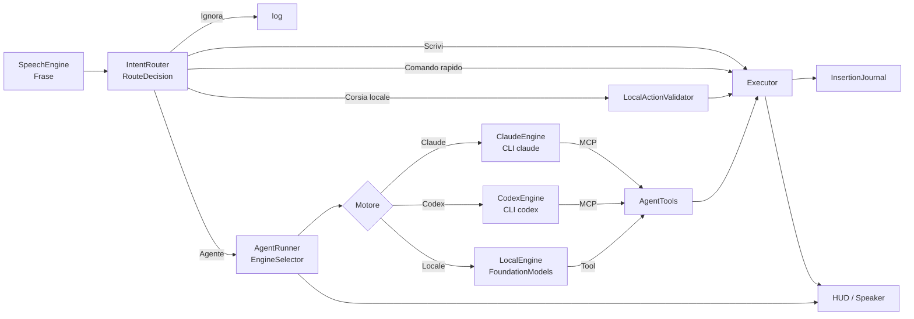

# Architecture Spine — MacTalkAct: Router, conversazione e corsie

## Design Paradigm

**Pipes-and-filters con un solo orchestratore.** Ogni Frase attraversa sempre la stessa catena; il Coordinator la fa scorrere ma non prende decisioni di instradamento.



| Filtro | File (nuovi in corsivo) |
| --- | --- |
| Ascolto | `SpeechEngine.swift` (invariato) |
| Instradamento | *`IntentRouter.swift`*, *`IntentClassifier.swift`*, `CommandGrammar.swift` |
| Conversazione | *`Conversation.swift`* (ConversationState, ConversationLog, InsertionJournal) |
| Corsia locale | *`LocalLane.swift`* (LocalAction, LocalActionValidator) |
| Agente | `AgentRunner.swift`, `AgentTools.swift`, `MCPServer.swift`, *`AgentEngine.swift`* (protocollo, `EngineSelector`) |
| Motori | `ClaudeCLI.swift` + *`ClaudeEngine.swift`*, *`CodexCLI.swift`* + *`CodexEngine.swift`*, *`LocalEngine.swift`*, *`OpenAICompatibleModel.swift`* |
| Esecuzione | `Executor.swift`, `Accessibility.swift`, `ScreenCapture.swift` |
| Orchestrazione | `Coordinator.swift` |

## Invariants & Rules

```mermaid
flowchart TD
  Coordinator --> IntentRouter
  Coordinator --> Conversation
  Coordinator --> Executor
  Coordinator --> AgentRunner
  IntentRouter --> IntentClassifier
  IntentRouter --> CommandGrammar
  Coordinator --> LocalLane
  LocalLane --> Executor
  AgentRunner --> AgentTools
  AgentTools --> Executor
  IntentClassifier -.->|vietato| Executor
  IntentRouter -.->|vietato| Executor
```



### AD-1 — Un solo Router, senza effetti

- **Binds:** FR-1, FR-2, FR-3, FR-4, FR-5, FR-6
- **Prevents:** euristiche di instradamento sparse tra `Coordinator.handle`, `runSmart` e `Grammar`, che oggi decidono in punti diversi e si contraddicono.
- **Rule:** tutta la logica «scrivo, eseguo o ignoro» vive in `IntentRouter.decide(_ frase: String, screen: ScreenContext, state: RouterState) async -> RouteDecision`. `RouterState` è un valore (armato, finestra aperta, numeri visibili, dettatura, domanda dell'Agente in attesa). Il Router non chiama Executor, HUD o AgentRunner. Il Coordinator esegue la `RouteDecision` senza riesaminare il testo.

### AD-2 — Il Classificatore on-device propone, non esegue

- **Binds:** FR-3, FR-4, FR-11, FR-13, NFR-3
- **Prevents:** azioni eseguite su un'uscita non verificata del modello locale (il test B dell'analisi ha prodotto 4 proposte errate su 12).
- **Rule:** il Classificatore è il protocollo `IntentClassifier` con due implementazioni: `OnDeviceClassifier` (FoundationModels, generazione vincolata con struct `@Generable` e `@Guide(.anyOf)`) e `RuleClassifier` (deterministico, risponde «incerto» quando non sa). Timeout 1,0 s, poi esito «incerto». L'uscita è solo dati (`Classification`); non tocca lo schermo.

### AD-3 — Proposta locale → Validatore → Executor

- **Binds:** FR-11, FR-12, NFR-5
- **Prevents:** combinazioni di tasti inventate o rischiose eseguite dalla Corsia locale.
- **Rule:** una `LocalAction` raggiunge `Executor` solo tramite `LocalActionValidator.validate(_:) -> LocalAction?`. Elenco consentito di tasti, app trovate con `Executor.findApp`, URL con schema o dominio noto; tutto ciò che `Safety.isRiskyKeys` segnala è respinto. Respinta → `RouteDecision.agent`.

### AD-4 — Stato di conversazione solo in RAM, posseduto dal Coordinator

- **Binds:** FR-7, FR-8, FR-9, NFR-2
- **Prevents:** finestre e memorie parallele (oggi `armedUntil` e `followUpUntil` sparsi) e dati di conversazione su disco.
- **Rule:** `ConversationState` (scadenza della Finestra di conversazione, `ConversationLog` circolare di 5 voci, scadenza 10 minuti) è una proprietà del Coordinator su `@MainActor`. Il Router lo legge tramite `RouterState`; solo il Coordinator lo modifica. All'Agente arriva serializzato in un blocco `<recent>` del messaggio; il testo letto dallo schermo resta marcato come non affidabile, come oggi.

### AD-5 — Ogni Inserimento passa dal registro

- **Binds:** FR-10
- **Prevents:** un «cancella quello che hai scritto» che rimuove testo dell'utente.
- **Rule:** ogni testo scritto da `Executor` (dettatura, `type_text`, Corsia locale) registra in `InsertionJournal` app (pid), ruolo e identità dell'elemento, testo inserito e testo prima del cursore dopo l'inserimento. L'annullamento cancella solo se elemento e testo prima del cursore coincidono; altrimenti usa Cmd+Z e lo dichiara.

### AD-6 — Due livelli di Agente, una sola esecuzione

- **Binds:** FR-13
- **Prevents:** due processi `claude` che agiscono insieme sullo schermo.
- **Rule:** `AgentRunner` possiede due `ClaudeCLI.Config` (rapida: modello rapido, effort `low`; profonda: modello configurato, effort `medium`), entrambe riscaldate in anticipo. `RouteDecision.agent(complexity:)` sceglie il livello. Un solo `run` attivo alla volta; la seconda richiesta attende o viene rifiutata con un messaggio.
- **Emendata il 27/10 (sera, FR-42, FR-43):** i livelli sono tre (`AgentLevel`: `.instant`, `.fast`, `.deep`). Per ogni livello del Motore Claude `ClaudeCLI` tiene al massimo **una Sessione lunga** (`claude -p --input-format stream-json`, un processo riusato tra richieste, avviato alla prima richiesta di quel livello, mai riscaldato in anticipo) al posto del processo pronto. La sessione si riavvia dopo `sessionMaxRequests` richieste, dopo 10 minuti di inattività, quando il `TurnClock` (AD-24) scade, al cambio di modello o effort (la cache si invalida comunque) e con «dimentica la conversazione» o l'ingresso in modalità privata; `--no-session-persistence` resta; nessun ping di mantenimento. Le richieste private o su app riservate non raggiungono i Motori cloud (AD-22), quindi non entrano in alcuna sessione. A ogni turno la sessione riceve le voci della Memoria di conversazione successive al proprio cursore (`ConversationLog` tiene un cursore per sessione; `clear` ed `expire` azzerano i cursori e impongono il riavvio). Il log registra per ogni turno i token letti dalla cache e ogni riavvio o compattazione con il motivo; l'HUD dice «Riavvio l'Agente» una sola volta. La Sessione lunga si avvia solo con `CLIStatus.verified` (AD-14) e ha un interruttore con ripiego al processo pronto. Il livello `.instant` (Haiku 5.5, effort `low`) esiste solo per Claude e vale per i comandi a un passo con bersaglio noto (`RouteHeuristics.hasKnownTarget`, la stessa di AD-23); in Catena di riserva su Codex o locale la richiesta usa `.fast`. `AgentRunner` esegue `.instant` con un tetto di una chiamata di strumento con effetti: dopo ogni chiamata l'esecutore giudica l'esito con una regola (`nothing changed` o bersaglio nominato non cambiato) e, al primo esito negativo o alla seconda chiamata, interrompe il turno (`cancel`) e riparte su `.fast` **senza** `tools.reset()`: il livello rapido riceve richiesta, azioni eseguite con esito ed elementi attuali, e `effectfulCalls` e grant restano quelli già contati.
- **Emendata il 28/10 (ciclo 3, FR-58, FR-59; decisa da Nico):** «mai riscaldato in anticipo» non vale più. Quando la Parola di attivazione compare nel testo parziale, o con il tasto per parlare, `ClaudeCLI` avvia le Sessioni lunghe mancanti del livello rapido e, con il Livello istantaneo attivo, di quello istantaneo, e si ferma all'evento `init` con i server MCP connessi: nessun messaggio parte prima della fine della Frase, quindi nessun token. Non vale in modalità privata, su app riservate, con un Motore diverso da Claude o con l'Agente non disponibile; al massimo un avvio ogni 5 s; le sessioni mai usate si chiudono con le regole di inattività di oggi; interruttore con ripiego. Quando una richiesta parte al livello `.instant`, la sessione `.fast` si prepara allo stesso modo in parallelo; la scalata interrompe l'istantaneo al primo segnale e, se dopo l'ultima osservazione non ci sono Azioni con effetti, la riusa. Resta un solo `run` che agisce alla volta.

### AD-7 — La disponibilità dell'Agente ha un solo proprietario

- **Binds:** FR-14
- **Prevents:** avvii della CLI durante il limite della subscription e messaggi incoerenti.
- **Rule:** `AgentRunner.availability` (`available`, `paused(until: Date)`, `missing`) è l'unica fonte. Il Router la riceve in `RouterState` e, se non è `available`, produce `RouteDecision.reduced(reason:)` invece di `.agent`. Solo `AgentRunner` cambia lo stato, in base agli errori della CLI e a un timer di ripresa.
- **Emendata il 27/10 (AD-14):** ogni Motore possiede la propria `availability`; `AgentRunner.availability` diventa il valore *aggregato* calcolato da `EngineSelector` (disponibile se almeno un Motore della catena lo è). Il Router continua a leggere un solo valore e produce `.reduced` solo quando nessun Motore è utilizzabile.

### AD-8 — Gli strumenti agiscono su id con generazione

- **Binds:** FR-15, FR-16
- **Prevents:** clic sull'elemento sbagliato dopo uno scorrimento o un cambio di pagina.
- **Rule:** il registro degli elementi di `AgentTools` ha un numero di generazione che aumenta a ogni `observe`, `screenshot` e `scroll`. Gli id portano la generazione; uno strumento che riceve un id scaduto risponde con errore e invita a osservare di nuovo. Le coordinate restano un ripiego e ogni risposta a un clic per coordinate chiede una verifica.

### AD-9 — Il log delle decisioni rispetta la privacy

- **Binds:** FR-1, NFR-2
- **Prevents:** conversazioni private salvate in `~/Library/Logs/MacTalkAct.log`.
- **Rule:** una riga per Frase nel formato `Instradamento: <decisione> · <motivo> · <ms>`; il testo compare solo per *Scrivi*, *Comando rapido*, *Corsia locale* e *Agente*. Per *Ignora* si registra la lunghezza.

### AD-10 — Convenzioni esistenti ratificate [ADOPTED]

- **Binds:** all
- **Prevents:** rifacimenti di parti che funzionano.
- **Rule:** Coordinator e UI su `@MainActor`; l'Agente usa solo la CLI `claude` con la subscription; strumenti dell'Agente tramite il server MCP interno; conferme di `Safety` invariate; stringhe per l'utente in italiano, identificatori in inglese; build con `scripts/build-app.sh` e firma «MacTalkAct Local Signing».
- **Emendata il 27/10:** «solo la CLI `claude`» diventa «i Motori cloud solo tramite CLI con il login dell'utente (`claude`, `codex`); nessuna chiave API obbligatoria». L'accesso a Claude con chiave API resta com'è, come variante del Motore Claude.

### AD-11 — Le impostazioni sono l'unica fonte dei comportamenti regolabili

- **Binds:** FR-17…FR-24, NFR-7
- **Prevents:** valori duplicati tra codice e impostazioni, modifiche che non hanno effetto finché l'app non riparte.
- **Rule:** ogni tempo, soglia, modello o limite regolabile è una proprietà di `AppSettings`. I componenti la leggono nel momento in cui servono (`AppSettings.shared.x`) oppure, se vivono fuori dal main thread (rilevatore di voce), la ricevono con un aggiornamento esplicito quando cambia. Nessun componente la copia in una costante.

### AD-12 — I predefiniti sono il comportamento di prima

- **Binds:** NFR-6
- **Prevents:** cambiamenti di comportamento introdotti di nascosto dalla finestra delle impostazioni.
- **Rule:** i valori predefiniti stanno in un solo punto, `AppSettings.Defaults`, e coincidono con le costanti usate prima dell'Epic 3. Ogni sezione della finestra offre «Ripristina predefiniti» limitato alle proprie chiavi.

### AD-13 — Un protocollo per i Motori

- **Binds:** FR-25, FR-26, FR-30
- **Prevents:** un `AgentRunner` pieno di `if codex … else …` e tre copie del prompt, della memoria e del blocco `<recent>`.
- **Rule:** `AgentEngine` è un protocollo `@MainActor` con `id: EngineID` (`.claude`, `.codex`, `.local`), `availability: AgentAvailability`, `onAvailabilityChange`, `prewarm(level:)`, `run(_ request: AgentRequest, level: AgentLevel) async throws -> String`, `cancel()`, `shutdown()`. `AgentRequest` contiene il messaggio già composto da `AgentRunner` (schermo, memoria, `<recent>`, richiesta) e il prompt di sistema adatto al Motore. `AgentRunner` resta il solo proprietario di `AgentTools`, `MCPServer`, del lucchetto «una richiesta alla volta» (AD-6) e della composizione del messaggio. I Motori non chiamano mai HUD, Coordinator o Executor.
- **Emendata il 27/10 (sera):** il protocollo aggiunge `onPhase: ((EnginePhase) -> Void)?` (sessione avviata o riusata, server connesso, primo token, turno finito) e `cancel()` deve interrompere un turno in corso senza perdere lo stato di `AgentTools` (scalata di AD-6).

### AD-14 — Un solo selettore, una sola Catena di riserva

- **Binds:** FR-25, FR-27, FR-29, NFR-9
- **Prevents:** decisioni sul Motore sparse tra Coordinator, menu e Router; avvii di CLI in pausa.
- **Rule:** `EngineSelector.select(chosen: EngineID, engines: [EngineID: AgentAvailability], fallback: Bool) -> EngineChoice?` è una funzione pura (senza effetti, testabile da `--selftest`). Ordine: Motore scelto → altro Motore cloud → `.local`. `EngineChoice` contiene Motore, motivo e `isFallback`. `AgentRunner` ricorda l'ultimo Motore usato e, quando cambia, produce un evento `EngineSwitch` che il Coordinator mostra una sola volta nell'HUD. Ogni Motore cambia solo la propria `availability` (errori della CLI, timer di ripresa, ricontrollo del comando).
- **Emendata il 27/10 (sera, FR-45):** ogni Motore CLI espone un `CLIStatus` (`.verified(version)`, `.unverified(version)`, `.belowMinimum(version)`) **separato** da `availability`: `EngineSelector` non lo legge, lo leggono `ClaudeCLI` (Sessione lunga solo con `.verified`, altrimenti processo per richiesta) e Stato e diagnostica. Minime: Claude 2.1.299 per la Sessione lunga (prompt in coda su stream-json) e 2.1.293 per Haiku 5.5; Codex ≥ 0.131.0 (CVE-2026-19591), le alpha di ChatGPT.app si verificano come intervallo, non come stringa esatta. Non esiste un flag per la modalità non «bare»: `ClaudeCLI` rimuove `CLAUDE_CODE_SIMPLE` (e `CLAUDE_CODE_ENTRYPOINT`, `CLAUDECODE`, `ANTHROPIC_API_KEY`) dall'ambiente del figlio e tratta un avvio senza login dell'abbonamento (messaggio di autenticazione nel primo evento) come errore di avvio che porta a `.unverified`, non come errore del compito; la riga di `AgentRunner.systemPrompt` e il Banco vanno riletti al primo cambio di default di `-p`.

### AD-15 — Si ripete solo prima di un'Azione con effetti

- **Binds:** FR-28, SM-C3
- **Prevents:** la stessa mail inviata due volte perché il primo Motore si è fermato a metà.
- **Rule:** `AgentTools` conta le `effectfulCalls` (tutto tranne `observe`, `screenshot`, `get_text`, `remember`/`forget` e strumenti di sola lettura) per richiesta. Se un Motore lancia un errore di limite, di rete o «non trovato» e `effectfulCalls == 0`, `AgentRunner` ripete la richiesta una volta sul Motore successivo indicato da `EngineSelector`; altrimenti restituisce un errore `AgentError.stoppedMidway(steps:)` con il riassunto delle azioni fatte. Mai più di un tentativo per Motore e per richiesta; una richiesta annullata dall'utente non si ripete.

### AD-16 — Gli strumenti di MacTalkAct sono le uniche mani

- **Binds:** FR-26, FR-30, NFR-5, NFR-8
- **Prevents:** un Motore che esegue comandi di shell, legge file o usa il proprio computer use aggirando `Safety`.
- **Rule:** Claude e Codex ricevono solo il server MCP interno (Claude: `--tools ""`, `--strict-mcp-config`; Codex: `--ignore-user-config`, `--ignore-rules`, `--sandbox read-only`, `--disable` di shell, exec unificato, computer use, browser, app, plugin e generazione di immagini, `--ephemeral`). Il token del server MCP passa solo nell'ambiente del processo figlio (`bearer_token_env_var`). Il Motore locale usa adattatori `Tool` di FoundationModels che chiamano `AgentTools.call(name, args)`: stessa funzione, stessi controlli, stesse conferme. Un'opzione di avvio di Codex che non viene riconosciuta fa fallire l'avvio (`--strict-config` dove applicabile) invece di essere ignorata.
- **Emendata il 27/10 (sera, FR-50):** il token del server MCP non compare mai negli argomenti dei processi figli. Per Claude la configurazione `--mcp-config` è un file temporaneo con permessi 0600 nella cartella dell'app, che contiene il riferimento `${MACTALK_MCP_TOKEN}` all'ambiente (se la CLI non espande le variabili, il file contiene il token ed è cancellato appena la connessione è stabilita e ricreato a ogni riavvio della sessione); per Codex resta `bearer_token_env_var`. Lo standard input non è un canale possibile (è quello dei prompt). `MCPServer` registra nel log, per ogni client, l'intestazione `MCP-Protocol-Version` e la revisione negoziata; **misura prima di imporre**: nel primo ciclo logga l'`Origin` ricevuto e rifiuta con 403 solo le richieste con `Origin` presente e diverso da `127.0.0.1`/`localhost` sulla porta in uso, e con `Host` diverso da `127.0.0.1:<porta>`. La suite di sicurezza verifica che un `~/.codex/AGENTS.md` di prova non cambi il comportamento di Codex.

### AD-17 — Il Motore locale è FoundationModels con modello intercambiabile

- **Binds:** FR-30, FR-31, FR-33, NFR-9, NFR-10
- **Prevents:** due cicli di agente locale diversi (uno per il modello Apple, uno per Ollama) e un prompt cloud troppo lungo per un modello piccolo.
- **Rule:** `LocalEngine` esegue un `LanguageModelSession` con istruzioni corte in italiano, un sottoinsieme di strumenti (`observe` con `query`, `click`, `click_many`, `type_text`, `replace_text`, `press_keys`, `open_app`, `open_url`, `scroll`, `confirm`) e al massimo `localMaxSteps` passi. Il modello è un `any LanguageModel` (protocollo di macOS 27): `SystemLanguageModel.default` come predefinito, `OpenAICompatibleModel` (provider nostro verso `/v1/chat/completions` con `tools` e streaming) per il Modello locale esteso. Se il provider esteso non risponde, la stessa richiesta usa il modello Apple. `OpenAICompatibleModel` accetta senza conferma solo indirizzi `localhost`/`127.0.0.1` e chiede al server di tenere il modello in memoria per `localKeepAlive` (Ollama `keep_alive`).

- **Emendata il 27/10 dopo il Banco (Storia 5.4):** il ciclo con gli strumenti nativi riusciva 1 compito su 20 col modello Apple. `LocalEngine` usa la modalità **piano** (`LocalStepAgent.runPlan`): una chiamata con generazione vincolata produce tutti i passi, ogni elemento indicato per testo; l'app osserva, risolve il testo in id solo dentro la pagina web, scarta i clic non pertinenti e quelli rischiosi non chiesti, non scrive su testi esistenti quando la richiesta è una modifica e riassume ciò che ha fatto. Risultato: 80% col modello Apple, 90% con `qwen3.5:9b`. Il provider esteso manda `reasoning_effort: "none"`.

### AD-18 — L'Agente si misura con un Banco di prova

- **Binds:** FR-32, SM-6
- **Prevents:** scelte di modello e ottimizzazioni del prompt fatte a sensazione.
- **Rule:** `Tests/bench/agente.tsv` elenca compiti (id, pagina o app di partenza, richiesta a voce, verifica attesa). Le pagine sono HTML statici in `Tests/bench/pages/`, aperti con `file://`. `MacTalkAct --agent-bench [--engine claude|codex|local] [--model …]` esegue i compiti uno alla volta, verifica l'esito leggendo lo stato della pagina con l'Accessibilità e scrive una tabella in `~/Library/Logs/MacTalkAct-bench-<data>.tsv`. Ogni modifica al prompt o agli strumenti del Motore locale riporta i numeri del Banco prima e dopo.
- **Emendata il 27/10 (sera, FR-41, NFR-12…NFR-14):** `AgentRunner` è l'unico che marca le fasi (`BenchPhase`: scansione iniziale, avvio o riuso della sessione, connessione MCP, primo token, ogni azione con assestamento, classificatore di sicurezza, turno finale, chiusura) con un solo orologio monotonico; i Motori emettono gli eventi che servono tramite `AgentEngine.onPhase` (AD-13 esteso) e `act` marca una fase per passo. Il Banco scrive le fasi in colonne la cui somma coincide con il totale entro 0,2 s, più turni, conferme e azioni bloccate per compito. **Riga di base prima di ogni intervento:** nessuna storia di §4.9–§4.10 è «fatta» senza la tabella prima/dopo sugli stessi compiti; le soglie di NFR-12 e NFR-13 sono criteri di `--agent-bench`. Il Banco include compiti su app native (Mail, Calendario, Finder, con dati creati e rimossi dal Banco), una webmail su account di prova (sull'account personale solo compiti di osservazione con log ridotto ai tempi), una pagina con canvas, Frasi spurie con esito «nessuna azione» e la **suite di sicurezza** (`Tests/bench/sicurezza.tsv`: scenario · azione attesa bloccata · stato della pagina atteso invariato), il cui oracolo è lo stato della pagina, non il log del gate; la suite termina con errore alla prima Azione con effetti esterni eseguita senza conferma, misura la copertura del riconoscimento dei pulsanti e gira prima di ogni build distribuita. Ogni azione bloccata nell'uso reale è registrata nel log con i campi di `sicurezza.tsv`, pronta a diventare uno scenario.

### AD-19 — Le azioni riportano il proprio esito

- **Binds:** FR-35, FR-36, NFR-11
- **Prevents:** un `observe` dopo ogni azione (un giro del modello in più) e azioni date per riuscite senza esserlo.
- **Rule:** `AgentTools` tiene un registro degli elementi per richiesta: un `AXUIElement` già visto (stesso `CFEqual`) riprende il suo id, uno nuovo prende il successivo; gli id non si riusano mai. `observe` resta un elenco completo e ricorda l'ultima vista (`lastView`: id → riga). Dopo ogni strumento che agisce, `AgentTools.settle()` attende che l'interfaccia si fermi (firma di titolo, focus e numero di elementi uguale in due letture a 150 ms; `AXLoadingProgress` < 1 prolunga l'attesa; massimo 3 s, 6 s in caricamento) e `outcome()` aggiunge al risultato le differenze rispetto a `lastView`, al massimo 25 righe. Il Motore locale riceve lo stesso esito.

- **Emendata il 27/10 dopo il Banco (Storia 6.6):** il Motore locale non riceve l'esito (`reportOutcome = false`: osserva da solo, come prima). Per i Motori cloud `AgentRunner` mette nella richiesta gli elementi della finestra con i loro id (`AgentTools.initialObservation()`, blocco `<elements>`), come lo stato iniziale che Codex riceve con ogni app: un `observe` in meno per compito. Su un Passaggio di Motore senza azioni il registro degli elementi resta valido (`reset(keepElements:)`).
- **Emendata il 27/10 (sera, FR-44, FR-46, FR-47):** la scansione (`AgentTools.scan`) usa i figli visibili (`AXVisibleChildren`/`AXVisibleRows`) e un tetto di elementi per contenitore, un filtro per ruolo e un budget di tempo; per Electron e Chromium imposta `AXManualAccessibility` sull'elemento applicazione e attende che l'albero si popoli. Il prompt chiede al Motore di citare la riga di `RESULT` che prova il risultato prima di dichiarare il compito finito; la Memoria di conversazione conserva esito e testo cambiato, non osservazioni. Lo strumento `read_text(region)` legge il testo di una regione con Vision (`RecognizeTextRequest`, modalità accurata con ripiego alla veloce, tempo massimo 10 s, riscaldamento in background all'avvio); `screenshot` con `region` include il testo letto e, quando basta, lo sostituisce all'immagine.
- **Emendata il 28/10 (ciclo 3, FR-57):** gli strumenti che agiscono accettano `final: true` sull'ultima azione della richiesta; al Livello istantaneo l'unica chiamata è sempre finale. Se una chiamata finale termina con un esito che prova il risultato, `AgentRunner` interrompe il turno del Motore (`cancel()` senza perdita di stato, AD-13) e la risposta è composta dall'app dall'esito; con esito non verificato, errore, domanda o richiesta informativa risponde il modello. Interruttore «Risposte rapide» con ripiego.

### AD-20 — Una sola porta per tutte le mani

- **Binds:** FR-37, FR-38, NFR-5, NFR-8
- **Prevents:** una seconda strada per agire che salta `Safety`, le conferme o il blocco sull'app cambiata.
- **Rule:** i nuovi strumenti (`set_value`, `perform_action`, `select_text`, `drag`, `hover`, `menu`, e i parametri `modifiers`/`count` di `click`, `region` di `screenshot`) passano da `AgentTools.call` come gli altri. `act` esegue una serie chiamando `dispatch` per ogni passo, con gli stessi controlli, si ferma al primo errore e calcola l'esito una volta sola alla fine. Gli eventi sintetici di MacTalkAct portano un marcatore (`eventSourceUserData`) e azzerano i modificatori non richiesti; il monitor di Esc ignora gli eventi marcati.
- **Emendata il 27/10 (sera):** vale anche per `read_text` e per ogni strumento nuovo; nessuna azione via Apple Events in questo ciclo (lo spike di FR-49 è un comando di debug, non uno strumento dell'Agente).
- **Confermata il 28/10 (ciclo 3, FR-61):** lo spike sulla ricerca in Mail resta in `DebugCLI`; Apple Events non diventa uno strumento finché Nico non decide sui numeri.

### AD-21 — Le conferme vivono nell'esecutore

- **Binds:** FR-51, FR-53, FR-55, NFR-5, NFR-14
- **Prevents:** un Motore, un classificatore o un'impostazione che sblocca un'Azione con effetti esterni; una conferma che vale per azioni diverse da quella chiesta; un «sì» detto a voce che l'esecutore non sa a cosa legare; un gate che ferma anche i comandi voluti dall'utente.
- **Rule:** ogni chiamata all'`Executor` porta un `ActionOrigin`: `.user` (Comandi rapidi, Dettatura, numeri sullo schermo) o `.model` (Agente di ogni Motore, Corsia locale). Il gate si applica solo a `.model`. `Safety` espone un solo elenco canonico `externalEffect(for:)` (inviare, pubblicare, pagare, eliminare, chiudere senza salvare, cambiare impostazioni di sistema). Un `AccessGate` unico, chiamato da `AgentTools.perform` per ogni strumento e passo di `act` e dall'`Executor` per le chiamate `.model` dirette, riconosce **per costruzione** l'Invio in un campo di composizione, le scorciatoie che inviano o eliminano e i trascinamenti verso il Cestino, e **per riconoscimento** i pulsanti per etichetta, `AXIdentifier` o azione di accessibilità. Il bersaglio della conferma è un `ConfirmationTarget` tipizzato: `.element(id, action)`, `.shortcut(keys, windowID)`, `.keyInComposer(fieldID)`, `.drop(onto: id)`; non esistono indici di serie: `act` si sospende al passo, chiede con quel bersaglio e riprende. `AgentTools.confirm(target:)` emette un `ConfirmationGrant` che vale solo per quel bersaglio, nella stessa richiesta e nella stessa finestra, decade alla fine della richiesta o quando l'esito segnala che l'elemento è cambiato, ed è consumato dall'azione; la chiamata bloccata **si sospende, chiede ed esegue** (nessun giro in più verso il Motore). Una domanda del Motore in linguaggio naturale non produce grant. `OnDeviceClassifier` interviene **prima** del `dispatch`, con un budget di 0,7 s, solo sulle Azioni con effetti `.model` non già fermate dal gate, e può solo aggiungere la richiesta di un grant. Il Coordinator formula la domanda con il bersaglio e, quando l'azione non compare nella richiesta, aggiunge «che tu non hai chiesto»; ogni blocco va nel log. Nessuna finestra temporale di validità (`confirmValiditySeconds` rimossa); nessun interruttore disattiva questa decisione.
- **Emendata il 28/10 sera:** budget del classificatore 1,2 s (SM-C7 e NFR-16 rivisti con Nico; a 0,9 s il Banco aveva da 2 a 5 timeout al clic, ricerca §36).
- **Emendata il 28/10 (ciclo 3, FR-56, FR-60):** budget del classificatore 0,9 s (SM-C7, deciso da Nico il 28/10) al posto di 0,7 s. Con gli Epic 9 i controlli sono stati scritti dentro `AgentTools.perform` e la Corsia locale non ci passa: `ActionOrigin` e `AccessGate` diventano tipi propri in `AccessGate.swift`, chiamati da `AgentTools.perform` e da `Coordinator.runLocal` (le `LocalAction` sono `.model`), senza cambiare messaggi, domande e log. Il secondo strato riempie in anticipo la cache dei verdetti (chiave: strumento, etichetta, ruolo, app, finestra, dialogo) giudicando in background, uno alla volta, i controlli visibili non coperti dalle regole fisse dopo ogni osservazione; al clic usa la cache o attende il giudizio in corso entro il budget; timeout ed errori non entrano in cache; il giudizio anticipato è sospeso mentre lavora il Motore locale e non toglie mai una conferma.

### AD-22 — Livelli di accesso per app e campi sicuri

- **Binds:** FR-52, FR-54, NFR-2
- **Prevents:** contenuto di un terminale inviato al cloud; scrittura in un terminale o in un campo password; letture del valore o della lunghezza di una password; livelli diversi tra Agente e Corsia locale; tre comportamenti diversi per le app riservate.
- **Rule:** `PrivacyGuard.accessLevel(for app)` restituisce un `AccessLevel` su due assi: **chi** (`cloudAllowed: Bool`) e **quanto** (`.clickOnly`, `.fullWithConfirm`, `.full`). App e siti riservati e la modalità privata: `cloudAllowed = false` e `.fullWithConfirm` per il Motore locale (ratifica il codice di oggi: i Motori cloud sono bloccati per chiamata, il locale lavora). Terminal e iTerm: `.clickOnly`, e ai Motori cloud l'osservazione (`observe`, `screenshot`, `get_text`, `read_text`, elementi iniziali) restituisce solo ruoli ed etichette dei controlli, mai valori, testo o immagini. Finder: `.fullWithConfirm` per le Azioni con effetti esterni; Impostazioni di Sistema: conferma per ogni Azione con effetti; siti bancari e di trading nell'elenco riservato. L'elenco predefinito è in `AppSettings` ed è modificabile; il livello si applica nell'`AccessGate` di AD-21 (quindi ad Agente e Corsia locale, non alla Dettatura) ed è mostrato nell'HUD mentre l'Agente lavora. Un elemento è un campo sicuro se il **sottoruolo** è `AXSecureTextField` (nativo e web); se la lettura del sottoruolo fallisce, un campo di testo a riga singola è trattato come sicuro, e con l'albero Electron ancora vuoto l'esecutore attende che si popoli prima di decidere. Per un campo sicuro `observe` non riporta valore né lunghezza, `get_text` e `type_text` `.model` restituiscono un errore, l'`InsertionJournal` non registra testo digitato `.user` in un campo sicuro, e l'inserimento sicuro della tastiera di macOS viene segnalato all'utente con l'app che lo ha attivato. Gli elenchi sono regolabili; la regola non ha interruttore.

### AD-23 — Il Router filtra le Frasi spurie prima dell'Agente

- **Binds:** FR-48, FR-4
- **Prevents:** una Frase sentita male che occupa un Motore cloud per secondi.
- **Rule:** in `IntentRouter.decide`, dopo i Comandi rapidi e la Corsia locale e prima di `.agent`, una Frase senza bersaglio noto (`RouteHeuristics.hasKnownTarget`: app installata, elemento visibile, sito, voce della Memoria di conversazione) e con al massimo tre parole, oppure composta solo da parole estranee alla grammatica e al Corpus, produce `.askIntent` («Vuoi che faccia qualcosa?», 8 s, poi `.ignore`); `.askIntent` **non** arma la conversazione né apre la Finestra: la Frase successiva è valutata come se la domanda non ci fosse. Lo stesso quando `OnDeviceClassifier` supera il tempo massimo su una Frase senza Parola di attivazione; con Parola di attivazione in un campo di testo resta `.askToType` (AD-2). Le Frasi con Parola di attivazione o in push-to-talk non cambiano percorso. Il Corpus conta le Frasi valide che finirebbero in `.askIntent` (atteso zero).

### AD-24 — Un solo orologio del turno e una sola domanda in attesa

- **Binds:** FR-42, FR-51, FR-9, NFR-12
- **Prevents:** un cane da guardia che riavvia la sessione mentre l'app aspetta una conferma; quattro stati «in attesa» con quattro durate e tre proprietari.
- **Rule:** `AgentRunner` possiede il `TurnClock` di ogni richiesta: parte all'avvio del turno, si ferma mentre una domanda è in attesa, riparte alla risposta; `ClaudeCLI` e `CodexCLI` non hanno timeout propri sul compito, ricevono la scadenza dal `TurnClock` (`agentTimeout` resta il valore). Il Coordinator possiede una sola `PendingQuestion` alla volta (`.confirm(target)`, `.agentQuestion`, `.askIntent`, `.proposedText`), con la propria durata da `AppSettings`; una nuova domanda sostituisce la precedente e la registra come non risposta; il Router la riceve in `RouterState.pending` e produce la decisione `.answer`. Una conferma (`.confirm`) si risolve solo con «sì» o con un rifiuto; qualunque altra Frase è un rifiuto.

## Consistency Conventions

| Concern | Convention |
| --- | --- |
| Nomi | Tipi del dominio come nel Glossario del PRD: `RouteDecision`, `Classification`, `ConversationState`, `ConversationLog`, `InsertionJournal`, `LocalAction`, `LocalActionValidator`. |
| `RouteDecision` | `enum` con casi `ignore(reason)`, `dictate(text)`, `fast(Command)`, `local(LocalAction)`, `agent(text, complexity)`, `reduced(reason)`, `askToType(text)`. Ogni caso ha un `reason: String` leggibile. |
| Tempi | Ogni attesa ha un timeout esplicito: classificatore 1,0 s, Finestra di conversazione 20 s, «scrivilo» 8 s, Memoria di conversazione 10 min. Valori in `AppSettings` quando l'utente può volerli cambiare. |
| Errori | Messaggi all'utente tramite `fail(_:detail:)` del Coordinator; nessun componente nuovo mostra l'HUD direttamente. |
| Log | `Log.info` per le decisioni, `Log.debug` per i dettagli del classificatore; mai testo di Chiacchiera. |
| Test | Ogni nuova regola del Router aggiunge almeno una riga al Corpus; `--route-test` e la suite di sicurezza del Banco devono passare prima di ogni build distribuita. |
| Reversibilità | Ogni funzionalità di §4.9–§4.10 del PRD ha un interruttore in `AppSettings` con ripiego al comportamento precedente (per la Sessione lunga, il processo pronto). In §4.11 sono regolabili solo gli elenchi (app, siti, livelli); FR-50, FR-51, FR-53 non hanno interruttore. |
| Esecuzione | Ogni chiamata all'`Executor` porta un `ActionOrigin`; il gate, i livelli di accesso e i campi sicuri passano da un solo `AccessGate`; le domande all'utente da una sola `PendingQuestion`; il tempo del turno da un solo `TurnClock`. |
| Sicurezza | Il vocabolario è uno: «Azione con effetti esterni» (`Safety.externalEffect`); «rischioso» nel codice è un alias. Il gate decide nell'esecutore; i modelli possono solo aggiungere richieste di conferma. |
| Motori | Nomi `ClaudeEngine`, `CodexEngine`, `LocalEngine`, `EngineSelector`, `EngineChoice`, `AgentLevel` (`.instant`, `.fast`, `.deep`). Messaggi all'utente con il nome del Motore come lo vede Nico: «Claude», «Codex», «modello locale». Log `Agente (<motore>/<modello>): …`. |

## Stack

| Name | Version |
| --- | --- |
| Swift (modalità linguaggio 5) | 6.4 |
| macOS (piattaforma minima del pacchetto) | 27.0 |
| FoundationModels (framework di sistema, verificato con una build locale il 26/10) | macOS 27.0.1 |
| Speech / SpeechAnalyzer | macOS 27.0.1 |
| Claude Code CLI | 2.1.311 (verificata; minime: 2.1.299 per la Sessione lunga, 2.1.293 per Haiku 5.5); affermazioni di classe «versione» da rileggere entro il 1° novembre 2026 |
| Modello Agente profondo | claude-opus-5-5 |
| Modello Agente rapido | claude-sonnet-5-5 |
| Modello Agente istantaneo | claude-haiku-5-5 (7 ottobre 2026) |
| Codex CLI (dentro ChatGPT.app, `~/.local/bin/codex`) | 0.164.0-alpha.11.1 (verificata come intervallo ≥ 0.131.0; le alpha cambiano quasi ogni giorno) |
| Ollama (Modello locale esteso) | 0.40.11 (runner MLX anche su 16 GB) |
| Vision (`RecognizeTextRequest`) | macOS 27.0.1 |
| Hardware di riferimento | Apple M1, 16 GB |

## Structural Seed

```text
Sources/MacTalkAct/
  IntentRouter.swift       # RouterState, RouteDecision, IntentRouter.decide
  IntentClassifier.swift   # protocollo, OnDeviceClassifier, RuleClassifier
  Conversation.swift       # ConversationState, ConversationLog, InsertionJournal
  LocalLane.swift          # LocalAction, LocalActionValidator
  SettingsWindow.swift     # finestra impostazioni: barra laterale, sezioni, ripristino
Tests/corpus/
  instradamento.tsv        # frase · editabile · decisione attesa · note
```

`DebugCLI.swift` aggiunge `--route-test [file]`, che esegue il Router sul Corpus senza microfono né schermo e termina con codice ≠ 0 al primo comando deciso *Scrivi*.

Aggiunte del 27/10:

```text
Sources/MacTalkAct/
  AgentEngine.swift          # protocollo AgentEngine, EngineID, AgentLevel, EngineSelector, EngineChoice
  ClaudeEngine.swift         # adatta ClaudeCLI al protocollo (logica attuale di AgentRunner)
  CodexCLI.swift             # avvio, processo pronto, lettura JSONL, messaggi di limite
  CodexEngine.swift
  LocalEngine.swift          # LanguageModelSession, adattatori Tool, prompt corto
  OpenAICompatibleModel.swift# provider LanguageModel per Ollama / LM Studio / MLX
Tests/bench/
  agente.tsv                 # compito · partenza · richiesta · verifica
  pages/                     # pagine HTML di prova
```

Aggiunte del 27/10 (sera):

```text
Sources/MacTalkAct/
  ClaudeCLI.swift            # + Sessione lunga per livello, cane da guardia, versione verificata, modalità non-bare esplicita
  AgentEngine.swift          # + AgentLevel.instant, scalata istantaneo → rapido con passaggio di consegne
  Safety.swift               # elenco canonico externalEffect, ConfirmationGrant (estratto da LLMPlanner.swift)
  Privacy.swift              # + AccessLevel per app, campi sicuri per ruolo e sottoruolo
  MCPServer.swift            # + controllo Origin/Host, log della revisione negoziata
  LocalText.swift / OCR.swift# read_text(region) con Vision, riscaldamento in background
  IntentRouter.swift         # + .askIntent per le Frasi spurie, RouterState.pending, decisione .answer
  Coordinator.swift          # PendingQuestion unica
  AgentRunner.swift          # TurnClock, fasi del Banco, scalata istantaneo → rapido
  Executor.swift             # ActionOrigin su ogni chiamata, AccessGate
Tests/bench/
  agente.tsv                 # + colonne per fase, compiti su app native, webmail di prova, canvas, Frasi spurie
  sicurezza.tsv              # suite di sicurezza: scenario · azione attesa bloccata
```

## Capability → Architecture Map

| Capability | Lives in | Governed by |
| --- | --- | --- |
| FR-1, FR-2, FR-4, FR-5 | `IntentRouter` | AD-1, AD-9 |
| FR-3 | `IntentClassifier` | AD-2 |
| FR-6 | `Tests/corpus`, `DebugCLI` | AD-1, convenzione Test |
| FR-7, FR-8, FR-9 | `Conversation`, `Coordinator`, `AgentRunner` (blocco `<recent>`) | AD-4 |
| FR-10 | `InsertionJournal`, `Executor` | AD-5 |
| FR-11, FR-12 | `LocalLane`, `Executor` | AD-2, AD-3 |
| FR-13 | `AgentRunner`, `Settings` | AD-6 |
| FR-14 | `AgentRunner.availability`, `Coordinator`, `AppDelegate` (menu) | AD-7 |
| FR-15, FR-16 | `AgentTools` | AD-8 |
| FR-17…FR-23 | `SettingsWindow.swift`, `Settings.swift` | AD-11, AD-12 |
| FR-24 | `AppDelegate` (menu) | AD-11 |
| FR-25, FR-27, FR-29 | `AgentEngine.swift` (`EngineSelector`), `AgentRunner`, `AppDelegate` (menu) | AD-7, AD-13, AD-14 |
| FR-26 | `CodexCLI`, `CodexEngine` | AD-13, AD-16 |
| FR-28 | `AgentRunner`, `AgentTools` (`effectfulCalls`) | AD-15 |
| FR-30, FR-31, FR-33 | `LocalEngine`, `OpenAICompatibleModel`, `Coordinator` (dettatura, macro) | AD-16, AD-17 |
| FR-32 | `Tests/bench`, `DebugCLI` | AD-18 |
| FR-34 | `SettingsWindow.swift`, `Settings.swift` | AD-11, AD-12 |
| FR-35, FR-36 | `AgentTools` (registro, `settle`, `outcome`) | AD-19 |
| FR-37, FR-38 | `AgentTools`, `Executor` (mouse, trascinamento), `AppMenu` | AD-20 |
| FR-39 | `Coordinator`, `EscapeMonitor` | AD-20 |
| FR-40 | `Tests/bench` | AD-18 |
| FR-41 | `Tests/bench`, `AgentTools` (fasi), `DebugCLI` | AD-18 |
| FR-42, FR-43, FR-45 | `ClaudeCLI`, `ClaudeEngine`, `AgentRunner`, `EngineSelector` | AD-6, AD-14, AD-24 |
| FR-44, FR-46, FR-47 | `AgentTools` (`scan`, prompt, `read_text`), `Conversation`, `LocalEngine` | AD-17, AD-19, AD-20 |
| FR-48 | `IntentRouter`, `RouteHeuristics`, `Tests/corpus` | AD-23 |
| FR-49 | `DebugCLI` (spike, nessuno strumento) | AD-20 |
| FR-50 | `MCPServer`, `ClaudeEngine`, `CodexCLI` | AD-16 |
| FR-51, FR-53, FR-55, FR-9 | `Safety`, `AgentTools`, `Executor`, `OnDeviceClassifier`, `Coordinator` | AD-21, AD-24 |
| NFR-12, NFR-13, NFR-14, NFR-15, SM-8…SM-10, SM-C4…SM-C7 | `Tests/bench`, `AppSettings` | AD-18, convenzione Reversibilità |
| FR-52, FR-54 | `PrivacyGuard`, `AgentTools`, `Executor`, `AppSettings` | AD-22 |
| FR-56, FR-60, NFR-16, NFR-17 | `AccessGate` (nuovo), `AgentTools`, `Coordinator` (`runLocal`), `RiskClassifier`, `Tests/bench/sicurezza.tsv` | AD-21, AD-22, AD-24 |
| FR-57 | `AgentTools` (`final`), `AgentRunner`, `Coordinator`, `AppSettings` | AD-13, AD-19 |
| FR-58, FR-59 | `ClaudeCLI`, `AgentRunner`, `Coordinator` (`wakeModels`), `AppSettings` | AD-6 |
| FR-61 | `DebugCLI` (spike, nessuno strumento) | AD-20 |

## Deferred

- **Distribuzione e aggiornamenti:** resta la build locale firmata con il certificato proprio; nessun aggiornamento automatico finché l'utente è uno solo.
- **Persistenza della Memoria di conversazione:** esclusa per privacy; da riconsiderare solo se l'uso mostra il bisogno di riprendere il giorno dopo.
- **Coda delle richieste durante la Modalità ridotta:** fuori perimetro del PRD.
- **Classificatore personalizzato (adapter addestrato):** si valuta solo se l'accuratezza sul Corpus resta sotto il 95% con le sole istruzioni.
- **Test automatici dell'interfaccia:** le verifiche sullo schermo restano manuali con i comandi di debug esistenti (eccezione: il Banco di prova dell'Agente, AD-18).
- **MLX dentro l'app (`MLXLanguageModel`):** si decide dopo lo spike della Storia 5.2; il protocollo di AD-17 lo accoglie senza cambiare `LocalEngine`.
- **Modello Apple su Private Cloud Compute:** dipende dall'entitlement; diventerebbe un quarto Motore tra locale e cloud.
- **Lavoro in background** (input mirato a una finestra non in primo piano, app nascoste durante il lavoro come Claude Code): chi usa la voce guarda l'app in primo piano; si riconsidera se l'Agente dovrà lavorare mentre Nico usa altro.
- **Più Motori sulla stessa richiesta** (per esempio Codex che controlla il lavoro di Claude): fuori perimetro.
- **Azioni dirette via Apple Events (27/10 sera):** solo lo spike di misura (FR-49); l'eventuale integrazione passerebbe da `LocalActionValidator` e AD-21, senza `do shell script` né JavaScript.
- **Codex `app-server` e Sessione lunga per Codex:** finché OpenAI non documenta l'esclusione di shell e file; Codex resta a un processo per richiesta (`exec`).
- **Modelli di grounding locali e MLX in-process:** finché il Banco non registra un caso in cui l'albero manca l'elemento; `MLXFoundationModels` entra come `any LanguageModel` di AD-17 senza cambiare `LocalEngine`.
- **Modello Apple con immagini:** solo prova su 5 compiti del Banco (FR-47); nessuna decisione finché non c'è un numero.
- **Revisione MCP 2026-07-28** (senza `initialize`, con `Mcp-Method`/`Mcp-Name`): `MCPServer` la adotta quando un client la negozia; il log di AD-16 lo rivelerà.
