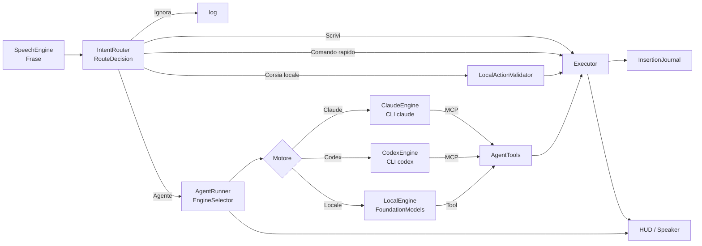
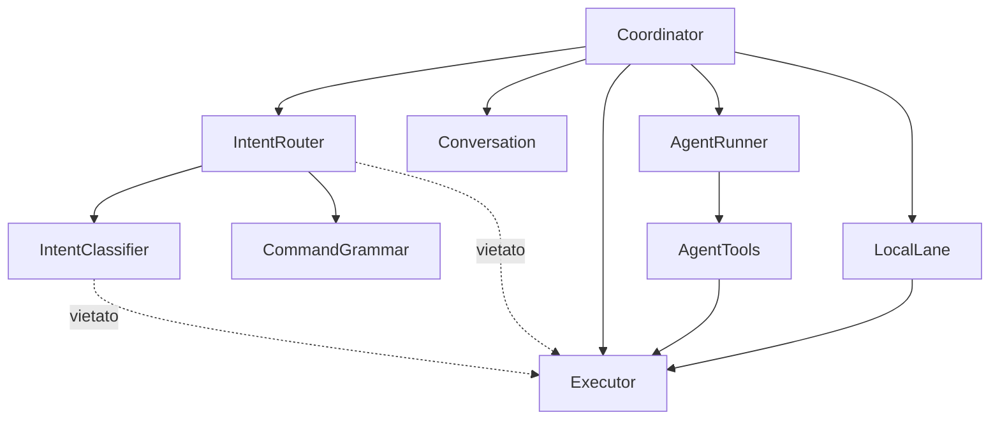

# Architecture Spine — MacTalkAct: Router, conversazione e corsie

## Design Paradigm

**Pipes-and-filters con un solo orchestratore.** Ogni Frase attraversa sempre la stessa catena; il Coordinator la fa scorrere ma non prende decisioni di instradamento.



| Filtro | File (nuovi in corsivo) |
| --- | --- |
| Ascolto | `SpeechEngine.swift` (invariato) |
| Instradamento | *`IntentRouter.swift`*, *`IntentClassifier.swift`*, `CommandGrammar.swift` |
| Conversazione | *`Conversation.swift`* (ConversationState, ConversationLog, InsertionJournal) |
| Corsia locale | *`LocalLane.swift`* (LocalAction, LocalActionValidator) |
| Agente | `AgentRunner.swift`, `AgentTools.swift`, `MCPServer.swift`, *`AgentEngine.swift`* (protocollo, `EngineSelector`) |
| Motori | `ClaudeCLI.swift` + *`ClaudeEngine.swift`*, *`CodexCLI.swift`* + *`CodexEngine.swift`*, *`LocalEngine.swift`*, *`OpenAICompatibleModel.swift`* |
| Esecuzione | `Executor.swift`, `Accessibility.swift`, `ScreenCapture.swift` |
| Orchestrazione | `Coordinator.swift` |

## Invariants & Rules



### AD-1 — Un solo Router, senza effetti

- **Binds:** FR-1, FR-2, FR-3, FR-4, FR-5, FR-6
- **Prevents:** euristiche di instradamento sparse tra `Coordinator.handle`, `runSmart` e `Grammar`, che oggi decidono in punti diversi e si contraddicono.
- **Rule:** tutta la logica «scrivo, eseguo o ignoro» vive in `IntentRouter.decide(_ frase: String, screen: ScreenContext, state: RouterState) async -> RouteDecision`. `RouterState` è un valore (armato, finestra aperta, numeri visibili, dettatura, domanda dell'Agente in attesa). Il Router non chiama Executor, HUD o AgentRunner. Il Coordinator esegue la `RouteDecision` senza riesaminare il testo.

### AD-2 — Il Classificatore on-device propone, non esegue

- **Binds:** FR-3, FR-4, FR-11, FR-13, NFR-3
- **Prevents:** azioni eseguite su un'uscita non verificata del modello locale (il test B dell'analisi ha prodotto 4 proposte errate su 12).
- **Rule:** il Classificatore è il protocollo `IntentClassifier` con due implementazioni: `OnDeviceClassifier` (FoundationModels, generazione vincolata con struct `@Generable` e `@Guide(.anyOf)`) e `RuleClassifier` (deterministico, risponde «incerto» quando non sa). Timeout 1,0 s, poi esito «incerto». L'uscita è solo dati (`Classification`); non tocca lo schermo.

### AD-3 — Proposta locale → Validatore → Executor

- **Binds:** FR-11, FR-12, NFR-5
- **Prevents:** combinazioni di tasti inventate o rischiose eseguite dalla Corsia locale.
- **Rule:** una `LocalAction` raggiunge `Executor` solo tramite `LocalActionValidator.validate(_:) -> LocalAction?`. Elenco consentito di tasti, app trovate con `Executor.findApp`, URL con schema o dominio noto; tutto ciò che `Safety.isRiskyKeys` segnala è respinto. Respinta → `RouteDecision.agent`.

### AD-4 — Stato di conversazione solo in RAM, posseduto dal Coordinator

- **Binds:** FR-7, FR-8, FR-9, NFR-2
- **Prevents:** finestre e memorie parallele (oggi `armedUntil` e `followUpUntil` sparsi) e dati di conversazione su disco.
- **Rule:** `ConversationState` (scadenza della Finestra di conversazione, `ConversationLog` circolare di 5 voci, scadenza 10 minuti) è una proprietà del Coordinator su `@MainActor`. Il Router lo legge tramite `RouterState`; solo il Coordinator lo modifica. All'Agente arriva serializzato in un blocco `<recent>` del messaggio; il testo letto dallo schermo resta marcato come non affidabile, come oggi.

### AD-5 — Ogni Inserimento passa dal registro

- **Binds:** FR-10
- **Prevents:** un «cancella quello che hai scritto» che rimuove testo dell'utente.
- **Rule:** ogni testo scritto da `Executor` (dettatura, `type_text`, Corsia locale) registra in `InsertionJournal` app (pid), ruolo e identità dell'elemento, testo inserito e testo prima del cursore dopo l'inserimento. L'annullamento cancella solo se elemento e testo prima del cursore coincidono; altrimenti usa Cmd+Z e lo dichiara.

### AD-6 — Due livelli di Agente, una sola esecuzione

- **Binds:** FR-13
- **Prevents:** due processi `claude` che agiscono insieme sullo schermo.
- **Rule:** `AgentRunner` possiede due `ClaudeCLI.Config` (rapida: modello rapido, effort `low`; profonda: modello configurato, effort `medium`), entrambe riscaldate in anticipo. `RouteDecision.agent(complexity:)` sceglie il livello. Un solo `run` attivo alla volta; la seconda richiesta attende o viene rifiutata con un messaggio.

### AD-7 — La disponibilità dell'Agente ha un solo proprietario

- **Binds:** FR-14
- **Prevents:** avvii della CLI durante il limite della subscription e messaggi incoerenti.
- **Rule:** `AgentRunner.availability` (`available`, `paused(until: Date)`, `missing`) è l'unica fonte. Il Router la riceve in `RouterState` e, se non è `available`, produce `RouteDecision.reduced(reason:)` invece di `.agent`. Solo `AgentRunner` cambia lo stato, in base agli errori della CLI e a un timer di ripresa.
- **Emendata il 27/10 (AD-14):** ogni Motore possiede la propria `availability`; `AgentRunner.availability` diventa il valore *aggregato* calcolato da `EngineSelector` (disponibile se almeno un Motore della catena lo è). Il Router continua a leggere un solo valore e produce `.reduced` solo quando nessun Motore è utilizzabile.

### AD-8 — Gli strumenti agiscono su id con generazione

- **Binds:** FR-15, FR-16
- **Prevents:** clic sull'elemento sbagliato dopo uno scorrimento o un cambio di pagina.
- **Rule:** il registro degli elementi di `AgentTools` ha un numero di generazione che aumenta a ogni `observe`, `screenshot` e `scroll`. Gli id portano la generazione; uno strumento che riceve un id scaduto risponde con errore e invita a osservare di nuovo. Le coordinate restano un ripiego e ogni risposta a un clic per coordinate chiede una verifica.

### AD-9 — Il log delle decisioni rispetta la privacy

- **Binds:** FR-1, NFR-2
- **Prevents:** conversazioni private salvate in `~/Library/Logs/MacTalkAct.log`.
- **Rule:** una riga per Frase nel formato `Instradamento: <decisione> · <motivo> · <ms>`; il testo compare solo per *Scrivi*, *Comando rapido*, *Corsia locale* e *Agente*. Per *Ignora* si registra la lunghezza.

### AD-10 — Convenzioni esistenti ratificate [ADOPTED]

- **Binds:** all
- **Prevents:** rifacimenti di parti che funzionano.
- **Rule:** Coordinator e UI su `@MainActor`; l'Agente usa solo la CLI `claude` con la subscription; strumenti dell'Agente tramite il server MCP interno; conferme di `Safety` invariate; stringhe per l'utente in italiano, identificatori in inglese; build con `scripts/build-app.sh` e firma «MacTalkAct Local Signing».
- **Emendata il 27/10:** «solo la CLI `claude`» diventa «i Motori cloud solo tramite CLI con il login dell'utente (`claude`, `codex`); nessuna chiave API obbligatoria». L'accesso a Claude con chiave API resta com'è, come variante del Motore Claude.

### AD-11 — Le impostazioni sono l'unica fonte dei comportamenti regolabili

- **Binds:** FR-17…FR-24, NFR-7
- **Prevents:** valori duplicati tra codice e impostazioni, modifiche che non hanno effetto finché l'app non riparte.
- **Rule:** ogni tempo, soglia, modello o limite regolabile è una proprietà di `AppSettings`. I componenti la leggono nel momento in cui servono (`AppSettings.shared.x`) oppure, se vivono fuori dal main thread (rilevatore di voce), la ricevono con un aggiornamento esplicito quando cambia. Nessun componente la copia in una costante.

### AD-12 — I predefiniti sono il comportamento di prima

- **Binds:** NFR-6
- **Prevents:** cambiamenti di comportamento introdotti di nascosto dalla finestra delle impostazioni.
- **Rule:** i valori predefiniti stanno in un solo punto, `AppSettings.Defaults`, e coincidono con le costanti usate prima dell'Epic 3. Ogni sezione della finestra offre «Ripristina predefiniti» limitato alle proprie chiavi.

### AD-13 — Un protocollo per i Motori

- **Binds:** FR-25, FR-26, FR-30
- **Prevents:** un `AgentRunner` pieno di `if codex … else …` e tre copie del prompt, della memoria e del blocco `<recent>`.
- **Rule:** `AgentEngine` è un protocollo `@MainActor` con `id: EngineID` (`.claude`, `.codex`, `.local`), `availability: AgentAvailability`, `onAvailabilityChange`, `prewarm(level:)`, `run(_ request: AgentRequest, level: AgentLevel) async throws -> String`, `cancel()`, `shutdown()`. `AgentRequest` contiene il messaggio già composto da `AgentRunner` (schermo, memoria, `<recent>`, richiesta) e il prompt di sistema adatto al Motore. `AgentRunner` resta il solo proprietario di `AgentTools`, `MCPServer`, del lucchetto «una richiesta alla volta» (AD-6) e della composizione del messaggio. I Motori non chiamano mai HUD, Coordinator o Executor.

### AD-14 — Un solo selettore, una sola Catena di riserva

- **Binds:** FR-25, FR-27, FR-29, NFR-9
- **Prevents:** decisioni sul Motore sparse tra Coordinator, menu e Router; avvii di CLI in pausa.
- **Rule:** `EngineSelector.select(chosen: EngineID, engines: [EngineID: AgentAvailability], fallback: Bool) -> EngineChoice?` è una funzione pura (senza effetti, testabile da `--selftest`). Ordine: Motore scelto → altro Motore cloud → `.local`. `EngineChoice` contiene Motore, motivo e `isFallback`. `AgentRunner` ricorda l'ultimo Motore usato e, quando cambia, produce un evento `EngineSwitch` che il Coordinator mostra una sola volta nell'HUD. Ogni Motore cambia solo la propria `availability` (errori della CLI, timer di ripresa, ricontrollo del comando).

### AD-15 — Si ripete solo prima di un'Azione con effetti

- **Binds:** FR-28, SM-C3
- **Prevents:** la stessa mail inviata due volte perché il primo Motore si è fermato a metà.
- **Rule:** `AgentTools` conta le `effectfulCalls` (tutto tranne `observe`, `screenshot`, `get_text`, `remember`/`forget` e strumenti di sola lettura) per richiesta. Se un Motore lancia un errore di limite, di rete o «non trovato» e `effectfulCalls == 0`, `AgentRunner` ripete la richiesta una volta sul Motore successivo indicato da `EngineSelector`; altrimenti restituisce un errore `AgentError.stoppedMidway(steps:)` con il riassunto delle azioni fatte. Mai più di un tentativo per Motore e per richiesta; una richiesta annullata dall'utente non si ripete.

### AD-16 — Gli strumenti di MacTalkAct sono le uniche mani

- **Binds:** FR-26, FR-30, NFR-5, NFR-8
- **Prevents:** un Motore che esegue comandi di shell, legge file o usa il proprio computer use aggirando `Safety`.
- **Rule:** Claude e Codex ricevono solo il server MCP interno (Claude: `--tools ""`, `--strict-mcp-config`; Codex: `--ignore-user-config`, `--ignore-rules`, `--sandbox read-only`, `--disable` di shell, exec unificato, computer use, browser, app, plugin e generazione di immagini, `--ephemeral`). Il token del server MCP passa solo nell'ambiente del processo figlio (`bearer_token_env_var`). Il Motore locale usa adattatori `Tool` di FoundationModels che chiamano `AgentTools.call(name, args)`: stessa funzione, stessi controlli, stesse conferme. Un'opzione di avvio di Codex che non viene riconosciuta fa fallire l'avvio (`--strict-config` dove applicabile) invece di essere ignorata.

### AD-17 — Il Motore locale è FoundationModels con modello intercambiabile

- **Binds:** FR-30, FR-31, FR-33, NFR-9, NFR-10
- **Prevents:** due cicli di agente locale diversi (uno per il modello Apple, uno per Ollama) e un prompt cloud troppo lungo per un modello piccolo.
- **Rule:** `LocalEngine` esegue un `LanguageModelSession` con istruzioni corte in italiano, un sottoinsieme di strumenti (`observe` con `query`, `click`, `click_many`, `type_text`, `replace_text`, `press_keys`, `open_app`, `open_url`, `scroll`, `confirm`) e al massimo `localMaxSteps` passi. Il modello è un `any LanguageModel` (protocollo di macOS 27): `SystemLanguageModel.default` come predefinito, `OpenAICompatibleModel` (provider nostro verso `/v1/chat/completions` con `tools` e streaming) per il Modello locale esteso. Se il provider esteso non risponde, la stessa richiesta usa il modello Apple. `OpenAICompatibleModel` accetta senza conferma solo indirizzi `localhost`/`127.0.0.1` e chiede al server di tenere il modello in memoria per `localKeepAlive` (Ollama `keep_alive`).

### AD-18 — L'Agente si misura con un Banco di prova

- **Binds:** FR-32, SM-6
- **Prevents:** scelte di modello e ottimizzazioni del prompt fatte a sensazione.
- **Rule:** `Tests/bench/agente.tsv` elenca compiti (id, pagina o app di partenza, richiesta a voce, verifica attesa). Le pagine sono HTML statici in `Tests/bench/pages/`, aperti con `file://`. `MacTalkAct --agent-bench [--engine claude|codex|local] [--model …]` esegue i compiti uno alla volta, verifica l'esito leggendo lo stato della pagina con l'Accessibilità e scrive una tabella in `~/Library/Logs/MacTalkAct-bench-<data>.tsv`. Ogni modifica al prompt o agli strumenti del Motore locale riporta i numeri del Banco prima e dopo.

## Consistency Conventions

| Concern | Convention |
| --- | --- |
| Nomi | Tipi del dominio come nel Glossario del PRD: `RouteDecision`, `Classification`, `ConversationState`, `ConversationLog`, `InsertionJournal`, `LocalAction`, `LocalActionValidator`. |
| `RouteDecision` | `enum` con casi `ignore(reason)`, `dictate(text)`, `fast(Command)`, `local(LocalAction)`, `agent(text, complexity)`, `reduced(reason)`, `askToType(text)`. Ogni caso ha un `reason: String` leggibile. |
| Tempi | Ogni attesa ha un timeout esplicito: classificatore 1,0 s, Finestra di conversazione 20 s, «scrivilo» 8 s, Memoria di conversazione 10 min. Valori in `AppSettings` quando l'utente può volerli cambiare. |
| Errori | Messaggi all'utente tramite `fail(_:detail:)` del Coordinator; nessun componente nuovo mostra l'HUD direttamente. |
| Log | `Log.info` per le decisioni, `Log.debug` per i dettagli del classificatore; mai testo di Chiacchiera. |
| Test | Ogni nuova regola del Router aggiunge almeno una riga al Corpus; `--route-test` deve passare prima di ogni build distribuita. |
| Motori | Nomi `ClaudeEngine`, `CodexEngine`, `LocalEngine`, `EngineSelector`, `EngineChoice`, `AgentLevel` (`.fast`, `.deep`). Messaggi all'utente con il nome del Motore come lo vede Nico: «Claude», «Codex», «modello locale». Log `Agente (<motore>/<modello>): …`. |

## Stack

| Name | Version |
| --- | --- |
| Swift (modalità linguaggio 5) | 6.4 |
| macOS (piattaforma minima del pacchetto) | 27.0 |
| FoundationModels (framework di sistema, verificato con una build locale il 26/10) | macOS 27.0.1 |
| Speech / SpeechAnalyzer | macOS 27.0.1 |
| Claude Code CLI | 2.1.310 |
| Modello Agente profondo | claude-opus-5-5 |
| Modello Agente rapido | claude-sonnet-5-5 |
| Codex CLI (dentro ChatGPT.app, `~/.local/bin/codex`) | 0.164.0-alpha.11.1 |
| Ollama (Modello locale esteso, candidato) | 0.40.11 |
| Hardware di riferimento | Apple M1, 16 GB |

## Structural Seed

```text
Sources/MacTalkAct/
  IntentRouter.swift       # RouterState, RouteDecision, IntentRouter.decide
  IntentClassifier.swift   # protocollo, OnDeviceClassifier, RuleClassifier
  Conversation.swift       # ConversationState, ConversationLog, InsertionJournal
  LocalLane.swift          # LocalAction, LocalActionValidator
  SettingsWindow.swift     # finestra impostazioni: barra laterale, sezioni, ripristino
Tests/corpus/
  instradamento.tsv        # frase · editabile · decisione attesa · note
```

`DebugCLI.swift` aggiunge `--route-test [file]`, che esegue il Router sul Corpus senza microfono né schermo e termina con codice ≠ 0 al primo comando deciso *Scrivi*.

Aggiunte del 27/10:

```text
Sources/MacTalkAct/
  AgentEngine.swift          # protocollo AgentEngine, EngineID, AgentLevel, EngineSelector, EngineChoice
  ClaudeEngine.swift         # adatta ClaudeCLI al protocollo (logica attuale di AgentRunner)
  CodexCLI.swift             # avvio, processo pronto, lettura JSONL, messaggi di limite
  CodexEngine.swift
  LocalEngine.swift          # LanguageModelSession, adattatori Tool, prompt corto
  OpenAICompatibleModel.swift# provider LanguageModel per Ollama / LM Studio / MLX
Tests/bench/
  agente.tsv                 # compito · partenza · richiesta · verifica
  pages/                     # pagine HTML di prova
```

## Capability → Architecture Map

| Capability | Lives in | Governed by |
| --- | --- | --- |
| FR-1, FR-2, FR-4, FR-5 | `IntentRouter` | AD-1, AD-9 |
| FR-3 | `IntentClassifier` | AD-2 |
| FR-6 | `Tests/corpus`, `DebugCLI` | AD-1, convenzione Test |
| FR-7, FR-8, FR-9 | `Conversation`, `Coordinator`, `AgentRunner` (blocco `<recent>`) | AD-4 |
| FR-10 | `InsertionJournal`, `Executor` | AD-5 |
| FR-11, FR-12 | `LocalLane`, `Executor` | AD-2, AD-3 |
| FR-13 | `AgentRunner`, `Settings` | AD-6 |
| FR-14 | `AgentRunner.availability`, `Coordinator`, `AppDelegate` (menu) | AD-7 |
| FR-15, FR-16 | `AgentTools` | AD-8 |
| FR-17…FR-23 | `SettingsWindow.swift`, `Settings.swift` | AD-11, AD-12 |
| FR-24 | `AppDelegate` (menu) | AD-11 |
| FR-25, FR-27, FR-29 | `AgentEngine.swift` (`EngineSelector`), `AgentRunner`, `AppDelegate` (menu) | AD-7, AD-13, AD-14 |
| FR-26 | `CodexCLI`, `CodexEngine` | AD-13, AD-16 |
| FR-28 | `AgentRunner`, `AgentTools` (`effectfulCalls`) | AD-15 |
| FR-30, FR-31, FR-33 | `LocalEngine`, `OpenAICompatibleModel`, `Coordinator` (dettatura, macro) | AD-16, AD-17 |
| FR-32 | `Tests/bench`, `DebugCLI` | AD-18 |
| FR-34 | `SettingsWindow.swift`, `Settings.swift` | AD-11, AD-12 |

## Deferred

- **Distribuzione e aggiornamenti:** resta la build locale firmata con il certificato proprio; nessun aggiornamento automatico finché l'utente è uno solo.
- **Persistenza della Memoria di conversazione:** esclusa per privacy; da riconsiderare solo se l'uso mostra il bisogno di riprendere il giorno dopo.
- **Coda delle richieste durante la Modalità ridotta:** fuori perimetro del PRD.
- **Classificatore personalizzato (adapter addestrato):** si valuta solo se l'accuratezza sul Corpus resta sotto il 95% con le sole istruzioni.
- **Test automatici dell'interfaccia:** le verifiche sullo schermo restano manuali con i comandi di debug esistenti (eccezione: il Banco di prova dell'Agente, AD-18).
- **MLX dentro l'app (`MLXLanguageModel`):** si decide dopo lo spike della Storia 5.2; il protocollo di AD-17 lo accoglie senza cambiare `LocalEngine`.
- **Modello Apple su Private Cloud Compute:** dipende dall'entitlement; diventerebbe un quarto Motore tra locale e cloud.
- **Più Motori sulla stessa richiesta** (per esempio Codex che controlla il lavoro di Claude): fuori perimetro.
